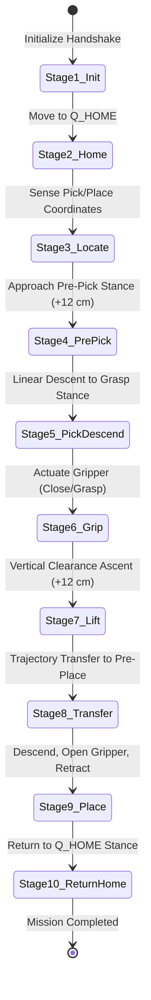

# System Architecture & Control Pipeline

**Course:** CSAI4014 – Algorithms for Intelligent Systems and Robotics  
**Group:** G04 | **Project:** P02 | **Batch:** B3  
**Project:** 6-DOF Robotic Arm Pick-and-Place using D-H Kinematics  

---

## 1. High-Level Modular Architecture

The system is organized into modular software subsystems with clear interfaces:

```text
+----------------------------------------------------------------------------------+
|                             USER / CLI / BENCHMARK                              |
|                       (src/main.py, src/benchmark_experiments.py)                |
+----------------------------------------------------------------------------------+
                                        |
                                        v
+----------------------------------------------------------------------------------+
|                   AUTOMATED 10-STAGE PICK-AND-PLACE ENGINE                       |
|                             (src/pick_and_place.py)                              |
+----------------------------------------------------------------------------------+
      |                                 |                                 |
      v                                 v                                 v
+--------------------+        +--------------------+        +--------------------+
|  INVERSE KINEMATICS|        | TRAJECTORY PLANNER |        | MOTION CONTROLLER  |
| - Analytical Decoup|        | - Cubic Polynomial |        | - 50 Hz Loop Sync  |
| - Damped Least Sq  |        | - Quintic Smooth   |        | - Safety Bounds    |
| - Solution Select  |        | - Trapezoidal LSPB |        | - Telemetry Log    |
| (src/inverse_kin.) |        | - Cartesian Linear |        | (src/motion_ctrl)  |
+--------------------+        +--------------------+        +--------------------+
      |                                 |                                 |
      +---------------------------------+---------------------------------+
                                        |
                                        v
+----------------------------------------------------------------------------------+
|                       FORWARD KINEMATICS & D-H ENGINE                            |
|             Standard D-H Matrix Multiplication & 6x6 Geometric Jacobian          |
|                 (src/dh_parameters.py, src/forward_kinematics.py)                |
+----------------------------------------------------------------------------------+
                                        |
                                        v
+----------------------------------------------------------------------------------+
|                       ROBOT CONNECTION BRIDGE & GRIPPER                          |
|         ZeroMQ Remote API Protocol (port 23000) / High-Fidelity Standalone       |
|             (src/robot_connection.py, src/gripper_controller.py)                 |
+----------------------------------------------------------------------------------+
                     |                                      |
                     v                                      v
     +-------------------------------+      +-------------------------------+
     |   LIVE COPPELIASIM SERVER     |      |    STANDALONE PHYSICS MOCK    |
     |  (UR5 Joint Handles, RG2)     |      |  (Deterministic Verification) |
     +-------------------------------+      +-------------------------------+
```

---

## 2. 10-Stage Pick-and-Place State Machine Sequence



---

## 3. Communication Bridge Implementation

`CoppeliaSimBridge` encapsulates all simulator transport logic:
1. **Synchronous Mode (`setStepping(True)`):** Prevents simulator drift by synchronizing Python execution with the simulation clock.
2. **Handle Resolution:** Automatically discovers handles whether prefixed with `/UR5/joint` or `UR5_joint`.
3. **Graceful Standalone Fallback:** Checks TCP port connectivity in under 200 ms. If CoppeliaSim is offline, it activates the internal high-fidelity simulation engine.
